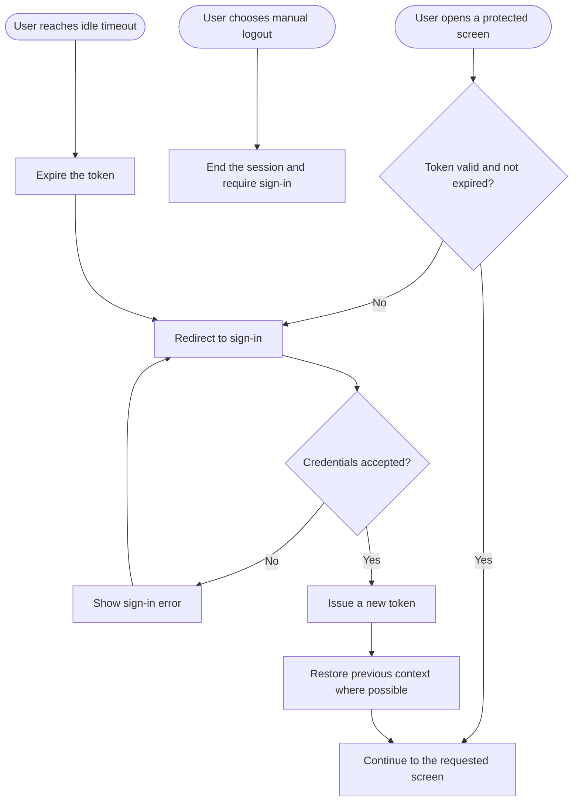

# Bukho Mabhula
### Junior Full-Stack Developer

📍 CPT, Woodstock &nbsp;|&nbsp; 📞 067 618 0426 &nbsp;|&nbsp; 📧 220235236@mycput.ac.za &nbsp;|&nbsp; 🐙 [github.com/Bukho127](https://github.com/Bukho127)

---

## 👤 Professional Overview

I am a Junior Full-Stack Developer and UX/UI Designer currently completing my Diploma in ICT at CPUT. I specialise in building modern web applications and SaaS user interfaces using React, Vue.js, and Node.js. I am highly proficient in implementing Material Design and Apple Human Interface Guidelines to deliver high-fidelity digital products backed by clean, scalable code.

---

## 🎓 Education

### Diploma in ICT Multimedia
**Cape Peninsula University of Technology (CPUT)** | 2024 – current

### High School
**Desmond Mpilo Tutu Secondary** | 2015 – 2019

---
## 💼 Work Experience

### Merchandiser
**Boxer Superstore** | 2023 – 2025
- Collaborated with store management to optimise visual layouts, ensuring brand standards were met.

### Chipper
**The Hussar Grill** | 2020 – 2021
- Followed precise operational procedures to ensure safety and consistency, demonstrating a high level of attention to detail and reliability.

---

## 🛠️ Skills

### Frontend Development
- **Languages:** HTML5, CSS3, JavaScript (ES6+)
- **Frameworks:** Vue.js (Vue Router, Vuex/Pinia)
- **Libraries:** React, jQuery, Tailwind CSS, Redux

### Backend & Logic
- **Languages:** JavaScript (Node.js with Express), Java, Python
- RESTful API design
- **Databases:** MySQL and MongoDB

---

## 🚀 Projects

### Pulse Guard | Active
> Community safety project with a mobile reporting app and an incident-management dashboard.

- **Dashboard:** [Open Pulse Guard dashboard](https://pulse-guard-dashboard.netlify.app/sign-in)
- **Mobile app:** [Download the Android APK](https://github.com/Bukho127/pulse-guard/releases/download/pulse-guard/application-40ccf1b4-5217-4f99-9dd4-e70e0eff2554.apk)

### [NextStep](https://github.com/Bukho127/next-step) | Active
> A data-driven career guidance platform to prevent academic misalignment by providing personalized career pathways based on verified student performance.

### [Coffee Shop – Morningscape](https://github.com/Bukho127/Morningscape-coffee-shop)
> Engineered and tested server-side endpoints to handle GET and POST requests, ensuring seamless data communication between the client and the server.

## 📋 References

| Name | Role | Contact |
|------|------|---------|
| Meagan Hamman | Lecturer, CPUT | hammanm@cput.ac.za |
| Z. Maqungo | High School Teacher | 083 925 8466 |

---

## 🎬 Mock Interview

<iframe
  src="https://drive.google.com/file/d/1QnZgvZ-4kS7fjyWvl20_Cs5BZPuH21mx/preview"
  width="100%"
  height="400"
  frameborder="0"
  allow="autoplay; fullscreen"
  allowfullscreen>
</iframe>

> ▶ [Click here to watch the Mock Interview](https://drive.google.com/file/d/1QnZgvZ-4kS7fjyWvl20_Cs5BZPuH21mx/view?usp=sharing)

---

---

## Reflection on Coding My CV in Markdown using STAR Method

**Situation**

As part of my PRP370 Digital Portfolio assessment, I was required to create my CV using **Markdown language** rather than a traditional word processor. This meant learning how Markdown syntax works and using it to produce a structured, professional document that could be rendered on GitHub.

**Task**

My task was to write a complete, well-structured CV entirely in Markdown covering my personal details, work experience, education, skills, and projects in a way that was both readable as raw code and visually clean when rendered.

**Action**

I studied Markdown syntax including headings (#, ##, ###), bold and italic formatting, bullet lists, tables, blockquotes, and horizontal rules (---). I structured the CV with clear sections and used emojis as visual anchors to make it scannable. I also ensured the document followed a logical hierarchy so it would render correctly on GitHub and GitHub Pages. I used the documents that were provided by the lecturer and a few videos to make sure that I had grasped the language well.

**Result**

I successfully produced a fully Markdown coded CV that renders cleanly on GitHub. The process deepened my understanding of lightweight markup languages and their role in developer documentation and portfolios. I now feel confident writing and structuring Markdown documents for professional use, and can produce well-structured documentation independently.

## Reflection on Mock Interview Experience using STAR Method

**Situation**

As part of my task, I was required to record a mock interview simulating a real-world job interview using the STAR method for a junior developer role. The video had to be embedded in my digital portfolio as evidence of my professional communication skills.

**Task**

My task was to present myself confidently on camera as a **Junior Full-Stack Developer**, clearly articulate my skills, experience, and projects, and respond to interview-style questions in a professional and structured manner.

**Action**

I prepared by reviewing common technical and behavioural interview questions for junior developer roles keeping in mind the companies I would like to work for. I practised explaining my projects in both technical and accessible terms. I set up a clean, well-lit recording environment, dressed professionally, and focused on maintaining eye contact with the camera throughout. I also structured my answers to be concise and relevant.

**Result**

The mock interview helped me identify my strengths such as clearly explaining technical concepts as well as areas to improve, like reducing filler words and managing nerves. The experience built my confidence in professional communication and gave me a realistic feel for what to expect in real industry interviews.

---

##  GitHub Pages

**Live Portfolio:** [Bukho-Mabhula.github.io](https://bukho-mabhula.github.io/)

---

## Reflection on Publishing to GitHub Pages using STAR Method

**Situation**

I was required to publish my CV and portfolio online using **GitHub Pages** a free static site hosting service built into GitHub. This would make my portfolio publicly accessible to lecturers and potential employers.

**Task**

My task was to configure my GitHub repository so that the Markdown-based CV would be published and accessible as a live website via GitHub Pages, and to ensure all content rendered correctly in a browser.

**Action**

I navigated to my repository settings on GitHub and enabled GitHub Pages by selecting the correct branch (`main`) and root folder as the source. I verified that my `README.md` file served as the homepage and checked that all Markdown formatting, links, and embedded content rendered correctly on the live site. I also reviewed the published page across different screen sizes to ensure it was readable.

**Result**

My portfolio was successfully published and is accessible online via GitHub Pages. This experience taught me how to deploy static web content using GitHub's built-in hosting tools a practical skill relevant to real-world developer workflows. It also gave me a sense of ownership over my professional online presence.

---

## Pulse Guard User Story Decision Diagram

This diagram organizes user flows from the [Pulse Guard Trello board](https://trello.com/b/L3GWnqCP/pulse-guard-project). Several story cards have checklist steps even when their descriptions are blank. The [user story task breakdown](agile/user-story-tasks.md) transcribes those checklist items. Some status wording still conflicts between card descriptions, checklists, and parent-card state.

```mermaid
flowchart TD
    subgraph Citizen[Citizen app]
        Start([Open Pulse Guard]) --> Registered{Registered before?}
        Registered -->|No| NewUser[Onboarding and registration checklist]
        Registered -->|Yes| ReturningUser[Onboarding and sign-in checklist]
        NewUser --> Home[Signed-in user]
        ReturningUser --> Home
        Home --> Safety{Check danger zones before leaving?}
        Safety -->|Yes| DangerZones[Review danger zones<br/>Danger-zone card]
        Safety -->|No| Crime{Crime in progress?}
        DangerZones --> Crime
        Crime -->|No| Home
        Crime -->|Yes| StartReport[Tap the + button<br/>Reporting card]
        StartReport --> Capture[Start live video or audio]
        Capture --> Location[Capture GPS location]
        Location --> Send[Send recording and location to nearest police station or private security]
        Send --> Confirmation[Confirm the report was sent]
    end

    subgraph Admin[Admin dashboard]
        AdminStart([Admin]) --> AdminSignIn[Sign in]
        AdminSignIn --> Overview[View incident overview]
        Overview --> Filter{Filter incidents?}
        Filter -->|Yes| ByTypeArea[Filter by type or area]
        Filter -->|No| ReadIncident[Read submitted incident]
        ByTypeArea --> ReadIncident
        ReadIncident --> Resolve{Mark as resolved?}
        Resolve -->|Yes| Resolved[Mark incident resolved]
        Resolve -->|No| Overview
        Overview -. optional .-> Statistics[View crime statistics and trends]
        Overview -. optional .-> HeatMap[Review heat map]
        Overview -. optional .-> Schedule[Create officer schedule]
    end
```

The diagram is a high-level map of the stories. The [Session security and token handling](https://trello.com/c/GcWRnXuO) card is shown separately below. The task breakdown page records checklist steps where the board provides them; unresolved status wording is left as shown in the export.

### Session security decision flow

This flow follows the requirements in the [Session security and token handling](https://trello.com/c/GcWRnXuO) card: idle timeout, manual logout, redirect after an expired or invalid token, re-authentication, and issuing a new token. The card mentions considering a refresh-token strategy but does not define that behavior, so it is not shown as implemented here. The SVG diagrams are displayed on the GitHub Pages user-stories page; this README keeps the editable Mermaid source.

---

## GitHub Pages and Agile Evidence

The Pages homepage is [`index.md`](index.md). It links to the Markdown pages for the [team charter](agile/charter.md), [user stories and Mermaid diagrams](agile/user-stories.md), [user story task breakdown](agile/user-story-tasks.md), [Product and Sprint Backlogs](agile/backlogs.md), and [Agile logbook](agile/logbook/index.md). The [Trello board](https://trello.com/b/L3GWnqCP/pulse-guard-project) contains the backlog and sprint cards.

The GitHub Pages site publishes from the `main` branch root using Jekyll. The Pages story page displays the journeys as SVG images, while the editable Mermaid source stays in [`agile/user-stories-source.md`](agile/user-stories-source.md). GitHub's repository Markdown view can render Mermaid source directly.
