# Pulse Guard User Stories and Decision Diagrams

These diagrams organize the stories recorded on the [Pulse Guard Trello board](https://trello.com/b/L3GWnqCP/pulse-guard-project). They complement the Trello cards and do not replace their acceptance criteria.

## Citizen stories

### [Reporting a crime in progress](https://trello.com/c/nJvVUjMJ)

- As a signed-in user, I want to open the app quickly so that I can report a crime without delay.
- As a user, I want to tap a clearly visible **+** button so that I can start a report in one action.
- As a user, I want the record screen to open with camera and audio ready so that I don't waste time during an emergency.
- As a user, I want to start live video or audio recording so that I can capture evidence of a crime as it happens.
- As a user, I want the app to send my recording and GPS location to the nearest police station or private security company so that help can be dispatched without manually sharing details.
- As a user, I want confirmation that my report was sent so that I know the app received it.

### Other citizen cards

- [New user](https://trello.com/c/tjHW9g0N) and [Returning user](https://trello.com/c/59I7BAqK): the export contains titles but no descriptions, so their paths are not specified in the board record.
- [Checking danger zones before leaving home](https://trello.com/c/vNznvXtL): the card description says the feature is finished and mentions waiting for the server, while the card remains open in the export.

## Citizen and admin journey

```mermaid
flowchart TD
    subgraph Citizen[Citizen app]
        Start([Open Pulse Guard]) --> Registered{Registered before?}
        Registered -->|No| NewUser[New-user flow<br/>Not described on Trello]
        Registered -->|Yes| ReturningUser[Returning-user flow<br/>Not described on Trello]
        NewUser --> Home[Signed-in user]
        ReturningUser --> Home
        Home --> Safety{Check danger zones before leaving?}
        Safety -->|Yes| DangerZones[Review danger zones<br/>Danger-zone card]
        Safety -->|No| Crime{Crime in progress?}
        DangerZones --> Crime
        Crime -->|No| Home
        Crime -->|Yes| StartReport[Tap the + button<br/>Reporting card]
        StartReport --> Capture[Start live video or audio]
        Capture --> Location[Capture GPS location]
        Location --> Send[Send recording and location to nearest police station or private security]
        Send --> Confirmation[Confirm the report was sent]
    end

    subgraph Admin[Admin dashboard]
        AdminStart([Admin]) --> AdminSignIn[Sign in]
        AdminSignIn --> Overview[View incident overview]
        Overview --> Filter{Filter incidents?}
        Filter -->|Yes| ByTypeArea[Filter by type or area]
        Filter -->|No| ReadIncident[Read submitted incident]
        ByTypeArea --> ReadIncident
        ReadIncident --> Resolve{Mark as resolved?}
        Resolve -->|Yes| Resolved[Mark incident resolved]
        Resolve -->|No| Overview
        Overview -. optional .-> Statistics[View crime statistics and trends]
        Overview -. optional .-> HeatMap[Review heat map]
        Overview -. optional .-> Schedule[Create officer schedule]
    end
```

## [Session security and token handling](https://trello.com/c/GcWRnXuO)

The card describes idle timeout, manual logout, redirect after an expired or invalid token, re-authentication, and issuing a new token. It says to consider a refresh-token strategy but does not define that behavior.

## Admin stories

The board includes these admin story cards. The supplied export has titles but no descriptions for several items, so their expected behavior and acceptance criteria are not recorded here.

- [Admin signs into the dashboard](https://trello.com/c/KPWIbi9v).
- [Admin views the incident overview](https://trello.com/c/TinbDlTB).
- [Admin filters incidents by type or area](https://trello.com/c/hU4uYAvk).
- [Admin reads a submitted incident](https://trello.com/c/kFlbPVQe).
- [Admin marks an incident as resolved](https://trello.com/c/mU8ohGsG).
- [Admin views crime statistics and trends](https://trello.com/c/Wvz94T9B).
- [Admin reviews the heat map](https://trello.com/c/vY4gCKeG).
- [Admin creates a schedule](https://trello.com/c/zixpGjY1). The card describes this as a Could-priority backlog item.

## Reflection

Mapping these stories helped me understand how a citizen report moves into the admin workflow. Some Trello cards have only titles or brief descriptions, so the diagrams are discussion aids rather than final acceptance criteria. I would confirm the missing details with the team, write testable criteria, and update the flow after those decisions. The numbered Trello screenshots show where the cards sit across the board's sprint lists.
