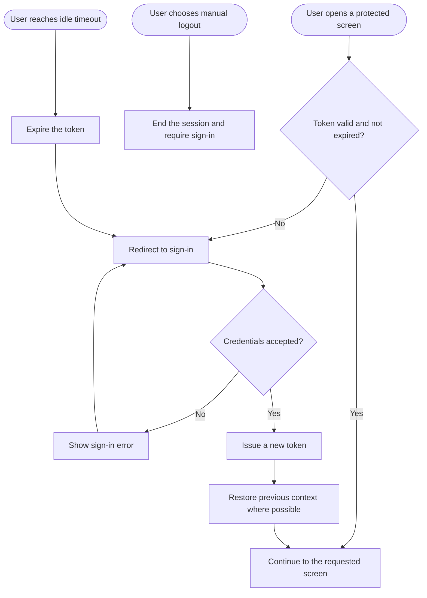

# Pulse Guard User Stories and Decision Diagrams

These diagrams organize the stories recorded on the [Pulse Guard Trello board](https://trello.com/b/L3GWnqCP/pulse-guard-project). They complement the Trello cards and do not replace their acceptance criteria.

## Citizen stories

### Reporting a crime in progress — Trello card #8

- As a signed-in user, I want to open the app quickly so that I can report a crime without delay.
- As a user, I want to tap a clearly visible **+** button so that I can start a report in one action.
- As a user, I want the record screen to open with camera and audio ready so that I don't waste time during an emergency.
- As a user, I want to start live video or audio recording so that I can capture evidence of a crime as it happens.
- As a user, I want the app to send my recording and GPS location to the nearest police station or private security company so that help can be dispatched without manually sharing details.
- As a user, I want confirmation that my report was sent so that I know the app received it.

### Other citizen cards

- **#93 New user** and **#94 Returning user:** the export contains titles but no descriptions. Confirm the story details with the team.
- **#95 Checking danger zones before leaving home:** the card says the feature is finished, but remains open on the board. Confirm its status and acceptance criteria.

## Citizen and admin journey

```mermaid
flowchart TD
    subgraph Citizen[Citizen app]
        Start([Open Pulse Guard]) --> Registered{Registered before?}
        Registered -->|No| NewUser[New-user flow<br/>Trello #93 - details to confirm]
        Registered -->|Yes| ReturningUser[Returning-user flow<br/>Trello #94 - details to confirm]
        NewUser --> Home[Signed-in user]
        ReturningUser --> Home
        Home --> Safety{Check danger zones before leaving?}
        Safety -->|Yes| DangerZones[Review danger zones<br/>Trello #95]
        Safety -->|No| Crime{Crime in progress?}
        DangerZones --> Crime
        Crime -->|No| Home
        Crime -->|Yes| StartReport[Tap the + button<br/>Trello #8]
        StartReport --> Capture[Start live video or audio]
        Capture --> Location[Capture GPS location]
        Location --> Send[Send recording and location to nearest police station or private security]
        Send --> Confirmation[Confirm the report was sent]
    end

    subgraph Admin[Admin dashboard]
        AdminStart([Admin]) --> AdminSignIn[Sign in<br/>Trello #5]
        AdminSignIn --> Overview[View incident overview<br/>Trello #13]
        Overview --> Filter{Filter incidents?}
        Filter -->|Yes| ByTypeArea[Filter by type or area<br/>Trello #12]
        Filter -->|No| ReadIncident[Read submitted incident<br/>Trello #6]
        ByTypeArea --> ReadIncident
        ReadIncident --> Resolve{Mark as resolved?}
        Resolve -->|Yes| Resolved[Mark incident resolved<br/>Trello #7]
        Resolve -->|No| Overview
        Overview -. optional .-> Statistics[View crime statistics and trends<br/>Trello #107]
        Overview -. optional .-> HeatMap[Review heat map<br/>Trello #110]
        Overview -. optional .-> Schedule[Create officer schedule<br/>Trello #115]
    end
```

## Session security — Trello card #4

The card describes idle timeout, manual logout, redirect after an expired or invalid token, re-authentication, and issuing a new token. It says to consider a refresh-token strategy but does not define that behavior.

## Admin stories

The board includes these admin stories. The export has card titles, but no descriptions for these items; add acceptance criteria to the Trello cards to define the expected behavior.

- **#5:** Admin signs into the dashboard.
- **#13:** Admin views the incident overview.
- **#12:** Admin filters incidents by type or area.
- **#6:** Admin reads a submitted incident.
- **#7:** Admin marks an incident as resolved.
- **#107:** Admin views crime statistics and trends.
- **#110:** Admin reviews the heat map.
- **#115:** Admin creates a schedule and assigns officers to shifts. The card describes this as a Could-priority backlog item.

## Reflection

Write your own reflection about how the user stories informed design and development, what was unclear, and what you learned from mapping the citizen and admin journeys. Include screenshots of the Trello cards as evidence.
